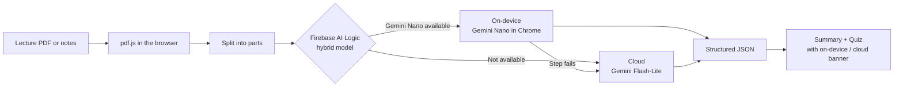

<div align="center">


# NotesNano

**Lecture notes in. Summary and quiz out.**
**On your laptop when it can, in the cloud when it can't.**

[](https://notesnano-2b39a.web.app)


*Built for [#BuildHybridAI 2026](https://firebasehybridaihackathon.devpost.com/) by students at FAST-NUCES Lahore*

</div>

---

## The problem

University students revise from 80-slide decks the night before an exam, often on patchy internet or during load-shedding. Pasting slides into a cloud chatbot is slow, needs a connection, and sends your course material to a server.

Most student laptops can now run a language model **inside Chrome**. NotesNano uses it first.

## What it does

| | |
|---|---|
| 📄 **Open a lecture PDF or paste notes** | The PDF is read in the browser with pdf.js and never uploaded. |
| 📝 **Summarize** | A title, key points and key terms. Long lectures are split into parts, summarized, then merged into one revision sheet. |
| ❓ **Quiz me** | 5 multiple-choice questions with explanations and a score. |
| 💬 **Ask your notes** *(new)* | Ask a question in plain English. NotesNano finds the most relevant passages of your notes **on your laptop**, then the AI answers **only from those passages**, with a supporting quote and the passages it used. If the answer isn't in your notes, it says so instead of making something up. |
| 🔀 **Choose where the AI runs** | **Auto**, **Private** or **Cloud** (see below). |
| 📍 **See where it ran** | Every result shows how many steps ran on your laptop and how many in the cloud. |

### Three modes, one SDK

| Mode | Firebase AI Logic setting | What happens |
|---|---|---|
| 🟢 **Auto** | `PREFER_ON_DEVICE` | Gemini Nano first. If Nano isn't available, or fails on a step, that step goes to the cloud. |
| 🔒 **Private** | `ONLY_ON_DEVICE` | Nothing leaves the laptop. Works offline once the model is downloaded. |
| ☁️ **Cloud** | `ONLY_IN_CLOUD` | Gemini Flash-Lite through the Gemini Developer API. |

## How it works



### How "Ask your notes" works

1. **Local retrieval, no AI:** [`src/ask.js`](src/ask.js) splits the notes into passages and scores each one against the question (TF-IDF-style keyword scoring). The best passages, up to about 6,000 characters, are kept. This keeps the prompt inside Gemini Nano's on-device input limit, even for long lectures.
2. **One grounded AI call:** the question and the chosen passages go to the same hybrid Firebase AI Logic model, with a JSON schema: `found`, `answer`, `quote`.
3. **Honest answers:** if `found` is false, the card is marked **"Not in your notes"**. Every answer shows where it ran (laptop or cloud), how long it took, and the passages it used, so you can check it.

### Firebase AI Logic, line by line

| Where | What |
|---|---|
| [`src/firebase.js`](src/firebase.js) | `initializeApp`, **App Check** (reCAPTCHA Enterprise, debug provider in dev), `getAI` with `GoogleAIBackend` |
| [`src/ai.js`](src/ai.js) | `getGenerativeModel` with `mode`, `inCloudParams` (model, system instruction, JSON schema) and `onDeviceParams` (`createOptions`, `promptOptions.responseConstraint`) |
| [`src/ai.js`](src/ai.js) | `initializeDeviceModel()` on the first click to download Gemini Nano, with progress |
| [`src/ai.js`](src/ai.js) | **Structured JSON on both paths**: `Schema` for the cloud, JSON-schema `responseConstraint` for Gemini Nano |
| [`src/ai.js`](src/ai.js) | `askNotes()`: grounded Q&A with a `found` / `answer` / `quote` schema on both paths |
| [`src/main.js`](src/main.js) | `result.response.inferenceSource` to show on-device vs cloud for every step |

## Run it locally

> **You need:** Node 20+ and desktop Chrome with on-device AI (16 GB RAM / 4+ cores, or a GPU with more than 4 GB VRAM, plus about 22 GB free disk).

**1. Firebase:** create a project, then go to **AI Logic → Get started → Gemini Developer API** and register a **Web app**.

**2. Clone and install:**
```bash
git clone https://github.com/ShortBatman/NotesNano.git
cd NotesNano
npm install
```

**3. Config:** copy `.env.example` to `.env.local` and fill in your web app's Firebase config.

**4. App Check** (required by AI Logic):
- Create a **reCAPTCHA Enterprise (Fraud Defense)** web key for your domain, register it under **Security → App Check → Apps**, and put the key in `VITE_RECAPTCHA_SITE_KEY`.
- For localhost: run the app once, copy the **debug token** from the browser console, and add it under **App Check → Apps → Manage debug tokens**.

**5. Chrome:** enable `chrome://flags/#prompt-api-for-gemini-nano-multimodal-input` and `chrome://flags/#gemma4-for-built-in-ai`, then restart Chrome.

**6. Run:**
```bash
npm run dev
```
Open http://localhost:5173

### Deploy
```bash
npm run build
npx firebase-tools deploy --only hosting
```

## Limits

- Gemini Nano needs desktop Chrome on a capable machine. Other browsers and smaller laptops use the cloud.
- Scanned PDFs (photos of pages) have no text layer, so they aren't supported yet.
- English notes work best on-device.

## Team

<table>
  <tr>
    <td align="center"><a href="https://github.com/ShortBatman"><br /><b>Umer Hassan</b></a><br /><sub>App development, Firebase AI Logic, deployment</sub></td>
    <td align="center"><a href="https://github.com/alihassan-cpp"><br /><b>Ali Hassan</b></a><br /><sub>Testing on different hardware and testing overall</sub></td>
    <td align="center"><a href="https://github.com/RMIN06"><br /><b>Muhammad Ibrahim</b></a><br /><sub>Test material (lecture PDFs)</sub></td>
    <td align="center"><a href="https://github.com/fast-na-ana"><br /><b>Abdullah Saeed</b></a><br /><sub>Accuracy review and UI feedback</sub></td>
  </tr>
</table>

## License

[Apache 2.0](LICENSE)
